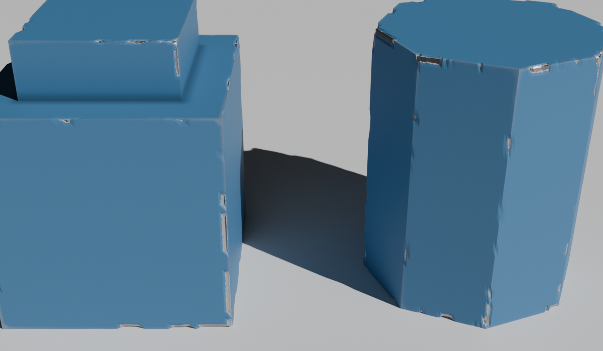
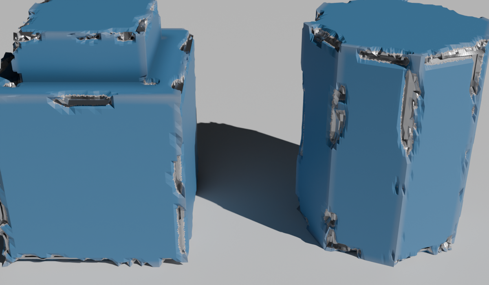

# Edge Chipper (Blender 5.2 extension)

Auto-detects hard edges on a mesh and adds chipped and broken edge damage: real
carved geometry plus a painted chip decal in the material. You can detail a
whole asset in seconds, without a sculpt pass.

| Worn preset | Broken preset |
|---|---|
|  |  |

## Install

1. In Blender 5.2, open **Edit > Preferences > Get Extensions**. In the top-right menu (˅), choose **Install from Disk...**.
2. Pick `dist/edge_chipper-1.0.0.zip`. You can also drag the zip into the Blender window.

## Quick use

1. Select one or more mesh objects.
2. Open the **3D Viewport > Sidebar (N) > Edge Chipper** tab and click **Add Edge Chips**. You can also use **Object menu > Add Edge Chips**. A preset is applied, scaled to each object's size.
3. Tweak the sliders. Everything stays live.
4. When you're happy, click **Apply**. The mesh is baked and the `ec_*` attributes stay on it, so the shader keeps working. You can also keep the modifier and bake normal and AO maps to your low poly.

## Controls

**Edge Detection**
- **Angle Threshold**: face angle above which an edge counts as hard.
- **Use Marked Sharp**: also uses edges you marked Sharp, for manual control.
- **Concave Chips**: lets inner (concave) edges chip too. The default is 0. Concave edges always feed the dirt mask.

**Damage Zone (outer vs inner)**
- **Edge Width**: how far damage reaches from an edge.
- **Outer Bias**: 0 damages every edge evenly. 1 damages only the outer extremities of the object; inner edges stay clean.
- **Outer Falloff**: how hard the damage concentrates on the outermost corners.
- **Height Bias**: positive values damage top edges more. Negative values damage bottom edges more, like scuffed feet.

**Chips**: Amount, Breakup (0 gives a continuous worn strip, 1 gives separate chips, above 1 gives ragged borders), Softness (slope of the chip walls), Chip Scale, Chip Detail, Distortion, Seed. The **Randomize** button gives a new pattern.

**Broken Edge Geometry**: Displace on/off, Subdivisions (carving density), Chip Depth.

## Shader (EC_EdgeDecal)

The add-on inserts the **EC_EdgeDecal** node group in front of each material's
Principled BSDF and keeps your existing Base Color, Roughness, Metallic and
Normal inputs. It reads three mesh attributes:

| Attribute | Meaning |
|---|---|
| `ec_chip` | chip mask |
| `ec_wear` | worn edge band |
| `ec_cavity` | concave edges (dirt) |

It paints the exposed material inside chips, a worn paint rim around each chip,
dirt in cavities, and bump. Group settings include Chip Color, Roughness and
Metallic, Fine Scale and Breakup (crisp micro detail, independent of mesh
density), Rim Width, Wear and Dirt, and **Show Mask** (R = chips, G = wear,
B = cavity). It works in both Cycles and EEVEE.

## Tips

- Subdivisions is uniform, so keep it at 3–4 on dense meshes. Even at 0, the masks are still made and the shader decal still shows. Chips follow the mesh resolution, though.
- Run **Apply Scale** first for consistent noise between objects.
- Width, depth and noise scale are in object space. Presets scale them to each object's size automatically.
